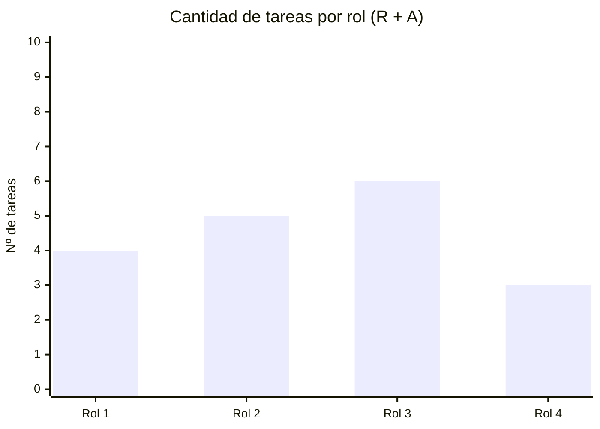

# 👥 Matriz RACI

> **R** = Responsable (ejecuta) · **A** = Aprobador (único por tarea) · **C** = Consultado · **I** = Informado

## Roles del proyecto

| Rol | Persona asignada |
|-----|-----------------|
| Project Owner | Manuela Calvo |
| Scrum Master | Joaquin Machado |
| Desarrollador (Firmware) | Josefina Giorgi |
| Desarrollador (Hardware) | Lucas Alarcón |
| Desarrollador (Nube e IA conversacional) | Victoria Boretto |

## Matriz

| ID | Tarea | Sponsor (KIBBO) | Product Owner | Scrum Master | Dev Hardware | Dev Firmware | Dev Nube/IA | Usuarios finales (SIC) |
|----|-------|:-:|:-:|:-:|:-:|:-:|:-:|:-:|
| 1.1.1 | Relevamiento con técnicos del SIC | A | R | I |  |  |  | C |
| 1.1.2 | Analizar el software KIBBO y su interfaz MCP | A |  |  |  |  | R |  |
| 1.1.3 | Elaborar el documento de casos de uso iniciales | A | R |  |  |  |  |  |
| 1.1.4 | Priorización de casos de uso y definición del alcance del prototipo | A | R |  | I | I | I |  |
| 1.2.1 | Definir requisitos funcionales | I | A | R | R | R | R |  |
| 1.2.2 | Definir requisitos no funcionales |  | A | R | R | R | R |  |
| 1.2.3 | Elaborar la matriz de trazabilidad |  | A | R |  |  |  |  |
| 1.3.1 | Definición de arquitectura general e interfaces |  | A |  |  |  | R |  |
| 1.3.2 | Definición de arquitectura de hardware |  | I | A | R |  |  |  |
| 1.3.3 | Definición de arquitectura de firmware |  | I | A |  | R |  |  |
| 1.3.4 | Definición de arquitectura de servicios en la nube |  | I | A |  |  | R |  |
| 1.3.5 | Definición de arquitectura de seguridad | C | I | R |  |  | A |  |
| 1.4 | Evaluación y selección de proveedores de STT/LLM/TTS | C | A |  |  |  | R |  |
| 2.1.1.1 | Selección de componentes |  | I |  | R | A |  |  |
| 2.1.1.2 | Diseño esquemático |  | I |  | R | A |  |  |
| 2.1.1.3 | Diseño de PCB |  | I |  | R | A |  |  |
| 2.1.1.4 | Diseño del gabinete | A | C | R | A |  |  |  |
| 2.1.1.5 | Generación de lista de materiales y calcular el costo unitario | I | A |  | R |  |  |  |
| 2.1.2.1 | Diseño de módulos |  | I |  | A | R |  |  |
| 2.1.2.2 | Diseño de comunicación dispositivo-backend |  | I |  |  | R | A |  |
| 2.1.3.1 | Diseño de flujos conversacionales por caso de uso priorizado |  | A |  |  |  | R | C |
| 2.1.3.2 | Diseño de integración con MCP de KIBBO | C | I |  |  | A | R |  |
| 2.1.4 | Elaborar el plan de verificación técnica |  | A | R |  |  |  |  |
| 2.1.5.1 | Solicitar cotizaciones y selección de proveedores | C/I | A |  | R |  |  |  |
| 2.1.5.2 | Generación de órdenes de compra | A | R |  |  |  |  |  |
| 2.1.5.3 | Realizar el seguimiento de envío e importación |  | A |  | R |  |  |  |
| 2.1.5.4 | Recepción e inspección de componentes |  | A |  | R |  |  |  |
| 2.1.6 | Revisión de diseño |  | I | R |  | A |  |  |
| 2.2.1.1 | Fabricación y montaje de PCB |  | I | A | R |  |  |  |
| 2.2.1.2 | Fabricación del gabinete |  | I | A | R |  |  |  |
| 2.2.1.3 | Ensamble del dispositivo y pruebas eléctricas |  | I | A | R |  |  |  |
| 2.2.2.1 | Implementación de captura y preprocesamiento de audio |  | I |  | A | R |  |  |
| 2.2.2.2 | Implementación de activación y gestión de estados |  | I | R | A |  |  |  |
| 2.2.2.3 | Implementación de conectividad y mecanismos de seguridad |  | I |  |  | R | A |  |
| 2.2.2.4 | Implementación de la reproducción de audio |  | I |  | R | A |  |  |
| 2.2.2.5 | Ejecutar pruebas unitarias del firmware |  | I | A | R | R |  |  |
| 2.2.3.1 | Integrar STT, intérprete y TTS |  | I |  |  | A | R |  |
| 2.2.3.2 | Integración MCP con KIBBO |  | I | A |  |  | R |  |
| 2.2.3.3 | Implementación de los casos de uso priorizados |  | A |  |  |  | R |  |
| 2.2.4.1 | Integración de hardware con firmware |  | I | A | R | R |  |  |
| 2.2.4.2 | Integración del dispositivo con la nube y KIBBO (integración punta a punta) |  | A |  |  |  | R |  |
| 2.2.5.1 | Ejecutar ensayos de reconocimiento de voz con ruido y a distancia |  | I |  | R | A |  |  |
| 2.2.5.2 | Ejecutar ensayos de latencia y conectividad |  | I | A |  |  | R |  |
| 2.2.5.3 | Ejecutar ensayos de seguridad |  | I |  |  | R | A |  |
| 2.2.5.4 | Elaborar informe de verificación técnica |  | A | R |  |  | R |  |
| 2.2.6 | Redacción de manual técnico y manual de usuario | I | A | R |  |  | R | C |
| 3.1.1 | Selección de los casos de uso a validar |  | A | R |  |  | R |  |
| 3.1.2 | Definición de instrumentos de feedback |  | R |  |  | A |  |  |
| 3.1.3 | Definición de casos de prueba y criterios de aceptación |  | A | R | R |  |  |  |
| 3.1.4 | Coordinación del piloto con un SIC | A | R |  | I | I | I | C |
| 3.2.1 | Ejecutar pruebas funcionales de casos de uso |  | A | R |  |  | R |  |
| 3.2.2 | Ejecutar pruebas piloto con técnicos |  | A | R | R | R | R |  |
| 3.2.3 | Registro de defectos, feedback y necesidades no cubiertas |  | A | R |  | R |  | C |
| 3.2.4 | Identificación y especificación de nuevos casos de uso | I | A |  |  |  | R | C |
| 3.2.5 | Priorización de nuevos casos de uso y solicitud de cambio a KIBBO | A | R | I | I | I | I |  |
| 3.2.6 | Ajuste del producto (hardware, firmware y nube) |  | A |  | R | R | R |  |
| 3.2.7 | Ejecutar las pruebas de regresión |  | A |  |  | R |  |  |
| 3.3 | Informe de validación y feedback de usuarios | I | A | R |  |  | R | C |
| 4.1.1 | Elaborar el informe final de pruebas | I | A |  | R |  |  |  |
| 4.1.2 | Registro de problemas presentados y soluciones |  | A/C | R | C | R | C |  |
| 4.2.1 | Entrega del prototipo y los repositorios | A | R |  |  |  |  |  |
| 4.2.2 | Realizar la demostración y capacitación | A | R |  |  |  |  |  |
| 4.2.3 | Elaborar el acta de aceptación | A | R |  |  |  |  |  |
| 4.3.1 | Análisis de desviaciones de alcance, tiempo y costo | I | A | R | C | C | C |  |
| 4.3.2 | Archivar la documentación del proyecto | I | A |  |  | R |  |  |
| 4.4 | Realizar la presentación final y reunión de cierre | A | R |  |  |  |  |  |
| 5.1 | Planificación: acta de constitución, EDT y diccionario, cronograma, presupuesto, planes de riesgos, comunicaciones y adquisiciones | A | R | C | C | C | C |  |
| 5.2 | Seguimiento y control: reuniones periódicas, informes de avance, control de cambios | I | A | R | I | I | I |  |
| 5.3 | Monitoreo de riesgos |  | A | R |  |  |  |  |
| 5.4 | Comunicación con interesados (KIBBO, SIC) | A | R |  |  |  |  | I |

> ⚠️ **Verificación obligatoria:** cada fila debe tener exactamente **1 A** y al menos **1 R**.

## Análisis de carga de responsabilidades

> [COMPLETAR: analizar si hay roles sobrecargados o con pocas responsabilidades y cómo se equilibra]

---

*Cátedra Gestión de Proyectos · FIUNER · 2026*
